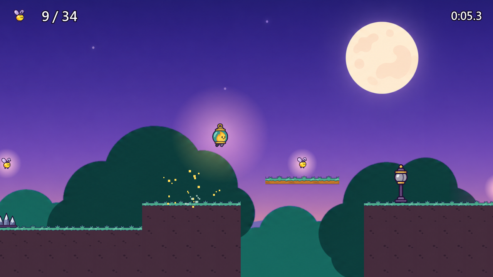

# Ember Hop 燈火跳跳 — Godot 4 平台跳躍遊戲 (2D Platformer)

A small 2D platformer made with **Godot 4.7**. You play Pip, a lantern spirit hopping through a
twilight forest. Collect fireflies, stomp gloom beetles, avoid spikes and reach the glowing stone gate.



## Play

1. Install [Godot 4.7](https://godotengine.org/download) (standard build, no .NET needed).
2. Open `project.godot` in Godot and press **F5**, or run `godot --path .` from this folder.

| Action | Keyboard | Gamepad |
| --- | --- | --- |
| Move 移動 | A / D or ← / → | Left stick / D-pad |
| Jump 跳躍 (hold for higher) | Space / W / ↑ / Z | A |
| Restart 重新開始 | R | Back |
| Pause 暫停 | Esc | Start |

## Features

- **Tuned jump feel:**
  - Fixed 60 Hz physics.
  - Coyote time and jump buffering (6 ticks each).
  - Variable jump height and a heavier fall.
  - Apex hang and corner correction.
  - The constants come from `jump_tuner.py` in the `platformer` skill: a full jump peaks at about 3 tiles.
- **Level 1 "Twilight Path":**
  - 123 × 15 tiles, built in code from `scripts/level_data.gd`.
  - Includes one-way platforms, a spike pit, 4 beetles, 34 fireflies, 2 checkpoints and a goal.
- **Juice:**
  - Squash and stretch.
  - Landing dust.
  - Trauma-based screen shake.
  - Hit-stop on stomp.
  - Glow sprites.
  - Two-layer parallax background (`Parallax2D`).
- **HUD and screens:**
  - Bilingual (English / 繁體中文) HUD, plus title, pause and win screens.

## Tests

```sh
godot --headless --path . --import                    # first run only
godot --headless --path . -s res://tests/run_tests.gd # exits 1 on failure
godot --path . -s res://tests/screenshot.gd           # rendered bot run, saves screenshots to user://shots
```

The headless suite checks the following:
- Level reachability, as a graph over all surfaces.
- Jump apex and tap-jump height.
- Coyote time and jump buffer.
- Beetle stomp versus side hit.
- That the main scene loads.

## Art and audio

All sprites, tiles and backgrounds are **AI-generated** with the OpenAI Codex CLI's built-in image
generation. They were then processed with `art/tools/process_art.py`:
- Magenta chroma key and edge decontamination.
- Grid split, shared scale and anchoring.
- Seamless tiles.

Raw generations are in `art/raw/`. Provenance for every file is in `art/asset-manifest.json`, and the
style rules are in `docs/art-direction.md`.

Sound effects are synthesized procedurally by `audio/gen_sfx.py` (Python stdlib only).

## Project layout

```
project.godot        engine config (1280x720, canvas_items / expand, 60 Hz physics)
scenes/main.tscn     entry scene; everything else is built from scripts
scripts/             player, level, camera, HUD, entities, input map, SFX autoload
tests/               headless test runner and screenshot bot
art/                 raw generations, final sprites, QA contact sheets, tools
audio/               WAV effects and their generator
docs/                art direction
```
